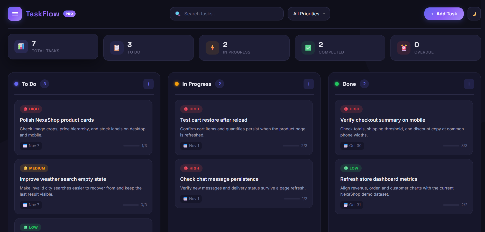

# 🚀 TaskFlow Pro – Task Management App

A modern, interactive, and responsive **Kanban Board Task Management Application** built using HTML5, CSS3, and Vanilla JavaScript. TaskFlow Pro helps you organize daily tasks, manage priorities, track progress, and stay productive through an intuitive drag-and-drop workspace.

---

## 📸 Project Preview

<p align="center">
  
</p>

---

## ✨ Features

- **Interactive Kanban Board:** Organize tasks into To Do, In Progress, and Completed columns.
- **Drag & Drop:** Easily move tasks between different workflow stages.
- **Task Management:** Create, edit, view, and delete tasks.
- **Priority Management:** Assign High, Medium, and Low priority levels.
- **Subtask Management:** Break larger tasks into smaller steps and track completion progress.
- **Due Date Tracking:** Set deadlines and identify overdue tasks.
- **Dashboard Statistics:** Monitor total, pending, in-progress, completed, and overdue tasks.
- **Smart Search:** Quickly find tasks using their titles and descriptions.
- **Priority Filtering:** Filter tasks according to their priority levels.
- **Dark & Light Mode:** Switch between themes for a comfortable viewing experience.
- **Local Storage:** Automatically save tasks and theme preferences in your browser.
- **Undo Delete:** Restore recently deleted tasks.
- **Responsive Interface:** Designed to work across desktop, tablet, and mobile screens.
- **Touch Drag & Drop:** Move tasks between columns on touch-enabled devices.

---

## 🛠️ Technologies Used

| Technology | Purpose |
|---|---|
| HTML5 | Application structure and semantic markup |
| CSS3 | Styling, layouts, animations, and responsive design |
| JavaScript (ES6+) | Application logic and interactive functionality |
| Local Storage API | Persistent browser-based task storage |
| Drag and Drop API | Interactive task movement |

---

## 📂 Project Structure

```text
taskflow-pro-kanban-board/
│
├── index.html
│
├── css/
│   └── style.css
│
├── js/
│   └── script.js
│
├── images/
│   └── preview.png
│
└── README.md
```

---

## ⚙️ Getting Started

Follow these instructions to run TaskFlow Pro on your local machine.

### 1. Clone the Repository

```bash
git clone https://github.com/YOUR-USERNAME/taskflow-pro-kanban-board.git
```

### 2. Navigate to the Project Directory

```bash
cd taskflow-pro-kanban-board
```

### 3. Run the Application

Open the `index.html` file in your preferred web browser.

Alternatively, use the **Live Server** extension in Visual Studio Code for a better development experience.

---

## 💡 How to Use

1. Open TaskFlow Pro in your browser.
2. Create a new task using the **Add Task** button.
3. Enter the task title, description, priority, and due date.
4. Add subtasks to break down larger tasks.
5. Move tasks between columns using drag and drop.
6. Use search and priority filters to find specific tasks.
7. Monitor your productivity through the dashboard statistics.
8. Switch between dark and light themes whenever you want.

---

## 💾 Data Storage

TaskFlow Pro uses the browser's **Local Storage API** to save task information and theme preferences.

Your tasks remain available after refreshing the page or reopening the application in the same browser.

**Note:** Data is stored locally in your browser and is not synchronized across different devices or browsers. Clearing browser storage may remove saved tasks.

---

## 🌐 Live Demo

**Try TaskFlow Pro online:**

🔗 [View Live Demo](https://ghareomkarr88.github.io/taskflow-pro-kanban-board/)

*Replace the URL with your actual GitHub Pages deployment link.*

---

## 🎯 Project Goals

This project was developed to demonstrate practical front-end development skills, including:

- Building interactive web applications using Vanilla JavaScript.
- Implementing dynamic DOM manipulation and event delegation.
- Managing application state and browser-based data persistence.
- Creating responsive user interfaces with CSS.
- Implementing drag-and-drop interactions.
- Developing reusable and maintainable front-end code.

---

## 👨‍💻 Author

**Omkar R. Ghare**

Front-End Developer | UI/UX Enthusiast

- GitHub: [@YOUR-USERNAME](https://github.com/ghareomkarr88)

---

## ⭐ Support

If you find this project useful or interesting, consider giving it a ⭐ on GitHub.

Your support and feedback are always appreciated!

---

<p align="center">
  <b>Designed & Developed with ❤️ by Omkar R. Ghare</b>
</p>
